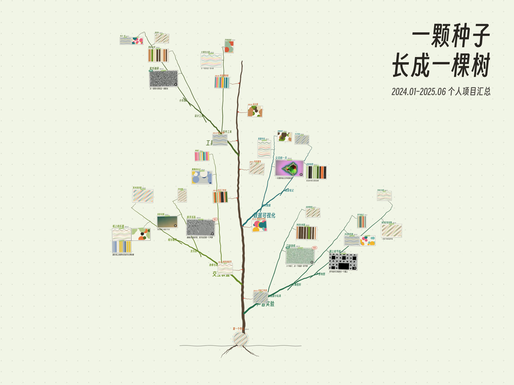
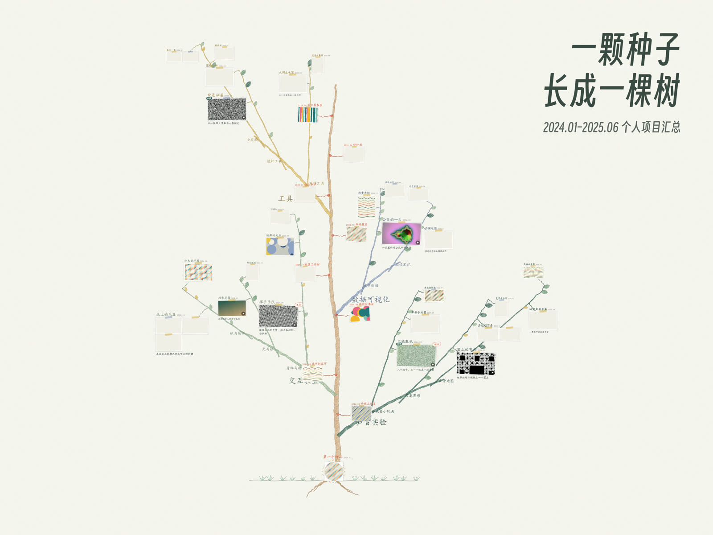

# 作品树 Portfolio Tree

把一段时间里做过的项目，长成一棵可以拖动、缩放、点开的树。

- **树干是时间**：根部是你的第一个作品，越往上越晚。
- **大枝是方向**：每个方向从它开始的那个月份长出来，作品越多枝越粗。
- **小枝是主题**，作品挂在小枝的细枝末端；**活动经历**结成树干旁的果实。
- **流动观看**：从一颗种子开始，按时间把整棵树长出来；作品多的月份多给一点时间，镜头跟着树往上走。
- 点开作品看大图 / 视频（有声音）、去体验链接、原文链接；海报墙；两种视觉风格；一行命令出横竖版封面。

纯静态网页，不需要构建，不需要后端。在线示例：<https://electro-dig.github.io/portfolio-tree/>（彩铅风格：[?theme=crayon](https://electro-dig.github.io/portfolio-tree/?theme=crayon)）

| 默认风格 `sketch` | 彩铅绘本 `crayon` |
|---|---|
|  |  |

仓库里的示例内容全部是虚构的，图片和视频由 `tools/make_demo_media.py` 生成。

## 快速开始

```bash
python tools/serve.py
```

打开 http://localhost:8080/ 。也可以直接双击 `index.html`（本地文件也能看，只是视频进度条可能不能拖）。

## 换成你自己的作品

1. 把图片、视频放进 `content/media/`。建议宽度不超过 1280 像素；视频用 mp4（H.264），每段几秒到二十秒就够。
2. 编辑 `content/content.js`：标题、时间范围、大枝 → 小枝 → 作品、活动、海报。文件里每个字段都有注释。
3. 运行素材扫描（需要 ffmpeg）：

   ```bash
   python tools/scan_media.py
   ```

   它会记下每个文件的尺寸、时长、有没有声音，写进 `content/media.js`，并给视频截一张封面图。**每次增删素材后都要跑一次。**
4. 刷新网页。

一件作品的写法：

```js
{ title: "口袋鼓机", date: "2024.02", tier: "F", media: ["clip01.mp4"],
  note: "八个格子，点一下就是一段节奏", stamp: "精选",
  play: [["在线试玩", "https://example.com/"]], link: "https://example.com/post" }
```

- `tier`：`"F"` 重点（大卡片，流动观看时镜头会停留）、`"N"` 一般（默认）、`"P"` 路过（小卡片）。
- `media` 可以放多个文件，会排成一个小网格。
- `play` 是“去体验”按钮，可以有多个；`link` 是“原文链接”。
- `stamp` 是卡片右上角的小印章，比如“精选”“展出”。

想放背景音乐或者一支录好的视频：在 `site` 里填 `music: "content/music.mp3"`、`film: "content/film.mp4"`。没填的话，对应的按钮和设置会自动隐藏。

## 视觉风格

- `sketch`：浅绿点阵纸，手绘墨线，枝条是实心色带（默认）。
- `crayon`：彩铅绘本。纸白底带纸纹，枝条是彩铅排线，细铅笔双线描边，沿小枝长叶子，地上有草。拆解见 [docs/style-crayon.md](docs/style-crayon.md)。

在 `content/content.js` 里设 `site.theme`，或者在网址后面加 `?theme=crayon` 临时试。颜色和字体都在 `assets/themes.css` 里，可以照着加一套自己的风格。

## 封面

```bash
python tools/make_cover.py                  # covers/ 下出 4 张：横版 4:3、竖版 3:4，各有带标题和不带标题
python tools/make_cover.py --theme crayon
```

需要本机装有 Chrome 或 Edge（找不到时用环境变量 `CHROME` 指定路径）。标题来自 `site.coverTitle` 和 `site.subtitle`。

## 网址参数

| 参数 | 作用 |
|---|---|
| `?theme=crayon` | 换视觉风格 |
| `?content=NAME` | 读取 `content-NAME/` 而不是 `content/`（比如一份不想放进仓库的私人内容，`content-private/` 已在 `.gitignore` 里） |
| `?view=x,y,z` | 从指定位置和缩放开始 |
| `?at=60` | 停在流动观看的第 60 秒 |
| `?wall` | 打开时直接显示海报墙 |
| `?cover` / `?cover=title` / `?cover=title-v` | 封面模式（隐藏界面、高清线条、横版 / 竖版标题） |

## 文件

```
index.html              页面
assets/engine/tree.js   布局、生长动画、绘制
assets/engine/site.js   交互：拖动缩放、点开、视频、设置、海报墙、封面
assets/themes.css       视觉风格
assets/fonts/           得意黑 Smiley Sans（SIL OFL 1.1，见 OFL.txt）
content/                你的内容（示例为虚构）
tools/                  scan_media.py / make_cover.py / make_demo_media.py / serve.py
docs/                   风格拆解、预览图
```

## 许可

- 代码：MIT，见 [LICENSE](LICENSE)。
- 字体：得意黑 Smiley Sans，© atelierAnchor，SIL Open Font License 1.1，见 [assets/fonts/OFL.txt](assets/fonts/OFL.txt)。
- 示例素材由脚本生成，随代码一起以 MIT 发布。

---

## English

**Portfolio Tree** grows your projects into a tree you can pan, zoom and open. The trunk is time (your first work is the seed at
the root), big branches are the fields you work in and sprout in the month they started, sub-branches are themes, works hang at
the twig ends, and events ripen as fruit beside the trunk. "流动观看" (Watch it grow) replays the whole tree growing month by month.

1. Put images / videos in `content/media/`, edit `content/content.js` (every field is commented).
2. Run `python tools/scan_media.py` (needs ffmpeg) to record media sizes into `content/media.js`.
3. Preview with `python tools/serve.py` → http://localhost:8080/.

Styles: `sketch` (default) and `crayon` (coloured-pencil picture book) — set `site.theme` or add `?theme=crayon`.
Covers: `python tools/make_cover.py [--theme crayon]` (needs Chrome or Edge). Static files only; no build step, no backend. Live demo: https://electro-dig.github.io/portfolio-tree/
Code is MIT; the bundled font Smiley Sans is SIL OFL 1.1. All demo content is fictional and generated by `tools/make_demo_media.py`.
