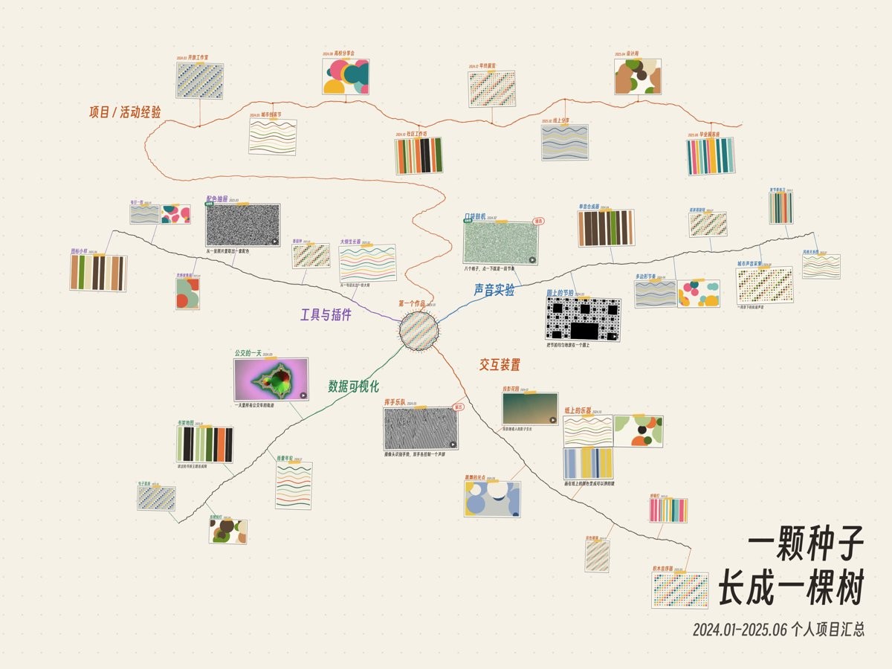
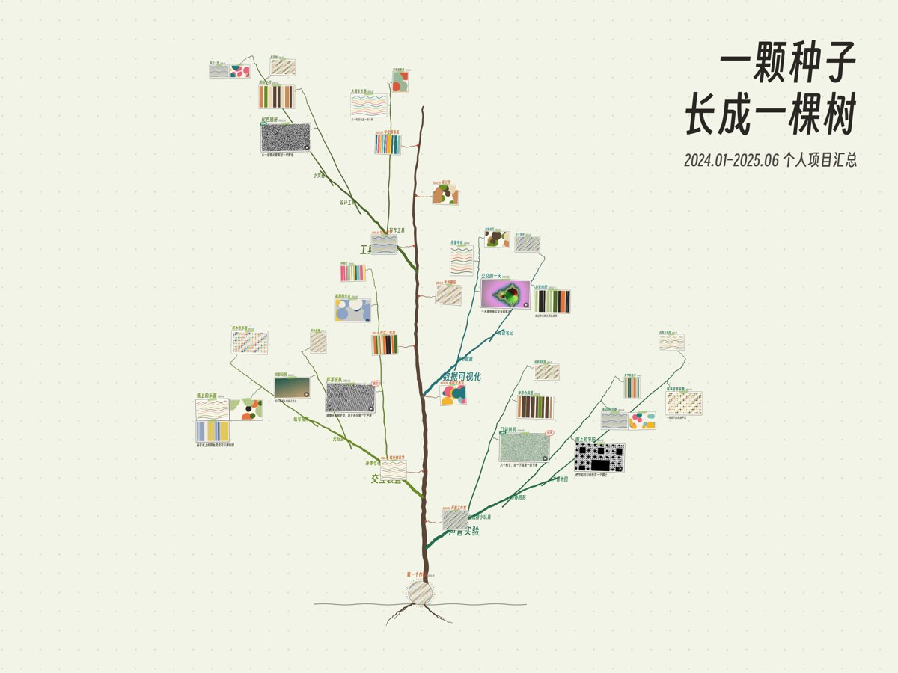

# 作品树 Portfolio Tree

把一段时间里做过的项目，长成一张可以拖动、缩放、点开的图。同一份内容，两种排法，页面左上角随时切换：

- **生长图**（默认，暖黄纸）：第一个作品是中间的一个圆；每个方向从圆上朝自己的方向长出一条线，作品按时间沿线一件件排开，左右交替；重点作品大，路过的作品小。活动经历排在最上方一条手绘时间线上，一根藤从圆连上去。
- **树形**（浅绿纸）：树干是时间，越往上越晚；大枝是方向，从它开始的那个月份长出来，作品越多枝越粗；小枝是主题，作品挂在细枝末端；活动经历结成树干旁的果实。
- **流动观看**：从一个点开始，按时间把整张图长出来，镜头跟着生长的地方走。
- 点开作品看大图 / 视频（有声音）、去体验链接、原文链接；海报墙；一行命令出横竖版封面。

纯静态网页，不需要构建，不需要后端。在线示例：<https://electro-dig.github.io/portfolio-tree/>（树形：[?mode=tree](https://electro-dig.github.io/portfolio-tree/?mode=tree)）

| 生长图 `map` | 树形 `tree` |
|---|---|
|  |  |

仓库里的示例内容全部是虚构的，图片和视频由 `tools/make_demo_media.py` 生成。

## 快速开始

```bash
python tools/serve.py
```

打开 http://localhost:8080/ 。也可以直接双击 `index.html`（本地文件也能看，只是视频进度条可能不能拖）。

## 换成你自己的作品

1. 把图片、视频放进 `content/media/`。建议宽度不超过 1280 像素；视频用 mp4（H.264），每段几秒到二十秒就够。
2. 编辑 `content/content.js`：标题、时间范围、大枝 → 小枝 → 作品、活动、海报。文件里每个字段都有注释。
3. 运行素材扫描（需要 ffmpeg）：

   ```bash
   python tools/scan_media.py
   ```

   它会记下每个文件的尺寸、时长、有没有声音，写进 `content/media.js`，并给视频截一张封面图。**每次增删素材后都要跑一次。**
4. 刷新网页。

一件作品的写法：

```js
{ title: "口袋鼓机", date: "2024.02", tier: "F", media: ["clip01.mp4"],
  note: "八个格子，点一下就是一段节奏", stamp: "精选",
  play: [["在线试玩", "https://example.com/"]], link: "https://example.com/post" }
```

- `tier`：`"F"` 重点（大卡片，流动观看时镜头会停留）、`"N"` 一般（默认）、`"P"` 路过（小卡片）。
- `media` 可以放多个文件，会排成一个小网格。
- `play` 是“去体验”按钮，可以有多个；`link` 是“原文链接”。
- `stamp` 是卡片右上角的小印章，比如“精选”“展出”。

大枝 → 小枝 → 作品：生长图把一个大枝下所有小枝的作品按时间排成一条线，树形把每个小枝画成单独的分杈。大枝上还可以写 `color`（生长图里的颜色）、`treeColor`（树形里的颜色）、`angle`（生长图里朝哪个方向长，单位是度，0 是正右，顺时针），不写就用默认的。

想放背景音乐或者一支录好的视频：在 `site` 里填 `music: "content/music.mp3"`、`film: "content/film.mp4"`。没填的话，对应的按钮和设置会自动隐藏。

## 两种模式

- `map` 生长图：暖黄点阵纸，手绘墨线（默认）。
- `tree` 树形：浅绿点阵纸，枝条是实心色带。

页面左上角的「生长图 / 树形」按钮切换，浏览器会记住上次选的。`content/content.js` 里的 `site.mode` 决定第一次打开时显示哪种，网址后加 `?mode=tree` 可以直接打开树形。颜色和字体在 `assets/themes.css` 里。

## 封面

```bash
python tools/make_cover.py                  # covers/ 下出 4 张：横版 4:3、竖版 3:4，各有带标题和不带标题
python tools/make_cover.py --mode tree      # 树形的封面
```

需要本机装有 Chrome 或 Edge（找不到时用环境变量 `CHROME` 指定路径）。标题来自 `site.coverTitle` 和 `site.subtitle`。

## 网址参数

| 参数 | 作用 |
|---|---|
| `?mode=tree` / `?mode=map` | 打开树形 / 生长图 |
| `?content=NAME` | 读取 `content-NAME/` 而不是 `content/`（比如一份不想放进仓库的私人内容，`content-private/` 已在 `.gitignore` 里） |
| `?view=x,y,z` | 从指定位置和缩放开始 |
| `?at=60` | 停在流动观看的第 60 秒 |
| `?wall` | 打开时直接显示海报墙 |
| `?cover` / `?cover=title` / `?cover=title-v` | 封面模式（隐藏界面、高清线条、横版 / 竖版标题） |

## 文件

```
index.html              页面
assets/engine/map.js    生长图：布局、生长动画、绘制
assets/engine/tree.js   树形：布局、生长动画、绘制
assets/engine/site.js   交互：拖动缩放、点开、视频、设置、海报墙、封面
assets/themes.css       两种模式的配色
assets/fonts/           得意黑 Smiley Sans（SIL OFL 1.1，见 OFL.txt）
content/                你的内容（示例为虚构）
tools/                  scan_media.py / make_cover.py / make_demo_media.py / serve.py
docs/                   预览图
```

## 许可

- 代码：MIT，见 [LICENSE](LICENSE)。
- 字体：得意黑 Smiley Sans，© atelierAnchor，SIL Open Font License 1.1，见 [assets/fonts/OFL.txt](assets/fonts/OFL.txt)。
- 示例素材由脚本生成，随代码一起以 MIT 发布。

---

## English

**Portfolio Tree** grows your projects into a map you can pan, zoom and open, in two layouts you can switch between on the page.
**Growth map** (default): your first work is a ring in the middle, each field grows out of it as a line with its works in time
order, and events sit on a hand-drawn timeline on top. **Tree**: the trunk is time, big branches are fields that sprout in the
month they started, sub-branches are themes, works hang at the twig ends and events ripen as fruit beside the trunk.
"流动观看" (Watch it grow) replays the whole thing growing.

1. Put images / videos in `content/media/`, edit `content/content.js` (every field is commented).
2. Run `python tools/scan_media.py` (needs ffmpeg) to record media sizes into `content/media.js`.
3. Preview with `python tools/serve.py` → http://localhost:8080/.

Layouts: `map` (default) and `tree` — switch on the page, set `site.mode`, or add `?mode=tree`.
Covers: `python tools/make_cover.py [--mode tree]` (needs Chrome or Edge). Static files only; no build step, no backend. Live demo: https://electro-dig.github.io/portfolio-tree/
Code is MIT; the bundled font Smiley Sans is SIL OFL 1.1. All demo content is fictional and generated by `tools/make_demo_media.py`.
